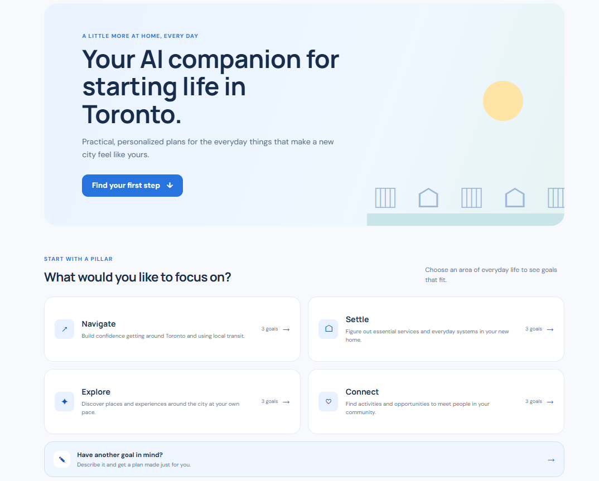
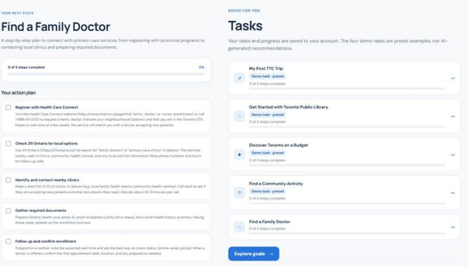

# Interview Summary

## 1. Customer discovery and jobs-to-be-done

We began with a customer discovery question: what makes it difficult for newcomers to become comfortable with everyday life in Toronto? We conducted three qualitative interviews with individuals who had recently arrived in Canada or were still getting familiar with Toronto. Rather than pitching our proposed solution, we asked about participants' existing routines, recent outings, information sources, and recurring frustrations. This helped us examine the customer's jobs-to-be-done before deciding which features belonged in the minimum viable product (MVP).

## 2. Interview backgrounds, pain points, and insights

We conducted three customer discovery interviews with our initial target segment, newcomers to Toronto, including two international graduate students and a recently relocated resident. Across the interviews, we identified three major pain points: fragmented information, unfamiliarity with local services and transportation, and time-consuming activity planning. Participants frequently relied on multiple platforms, including Google Maps, social media, and AI tools, to discover places, navigate the city, and organize outings. This required constant switching between applications and manually verifying information. They also struggled with understanding public transit systems, finding everyday essentials, and identifying affordable activities suited to their preferences. Our key insight was that the primary challenge was not a lack of available information, but the difficulty of turning scattered information into personalized, actionable guidance. These findings highlighted an opportunity for us to simplify newcomers' daily lives through an integrated, personalized city companion.

## 3. Customer value proposition

These findings helped define our customer value proposition: helping newcomers navigate and settle into Toronto with personalized, actionable guidance in one platform. Rather than simply providing information or recommendations, we aim to help users accomplish specific goals through AI-generated, step-by-step action plans tailored to their individual circumstances. This directly addresses the fragmented information and lack of practical guidance identified in our interviews. Our goal is to reduce the time and effort newcomers spend researching unfamiliar processes, while building their confidence and independence in navigating everyday life in Toronto.

## 4. Product decisions: translating research into four pillars

We organized the product around four pillars that reflect the customer jobs identified in our interviews. Navigate addresses uncertainty with TTC and GO Transit. Settle focuses on everyday services and unfamiliar local processes. Explore supports discovering neighborhoods and budget-friendly activities. Connect offers ways to find community activities, although this need was less directly supported by our interviews. Each pillar gives newcomers a clear starting point, while the mission workflow provides a consistent way to act on a goal.

*RoamTO home page: the four pillars organize newcomer goals.*

## 5. MVP prioritization

Based on our interview findings, we prioritized personalized, step-by-step missions as the core feature of our MVP. Since newcomers struggled to turn scattered information into practical actions, we focused on building a workflow where users select a goal, provide relevant preferences, receive an AI-generated action plan, and track their progress. This directly supports our customer value proposition by reducing the research and planning required to complete unfamiliar tasks. Rather than developing comprehensive transit navigation, social media integration, or advanced itinerary optimization immediately, we prioritized a focused solution that could demonstrate our core product value.

## 6. Translating customer insights into our prototype

Our mission on finding a family doctor demonstrates how we translated customer insights into product features. After selecting a goal, users can specify their preferred location, current situation, and additional constraints. RoamTO uses these inputs to generate a personalized action plan containing clear steps, practical tips, and relevant official resources. Users can then revise their plans, save them, and track completion through a checklist and task dashboard. These features directly address the pain points identified in our interviews: personalization reduces irrelevant information, step-by-step guidance simplifies unfamiliar processes, and progress tracking helps users turn recommendations into actions.

Although finding a family doctor was not specifically mentioned by interviewees, we selected it as a representative example of the broader challenge of navigating unfamiliar local services. Customer discovery identified the underlying problem, while solution discovery guided our decision to address it through personalized missions.

*Generated steps and saved tasks: from a personalized plan to tracked progress.*
