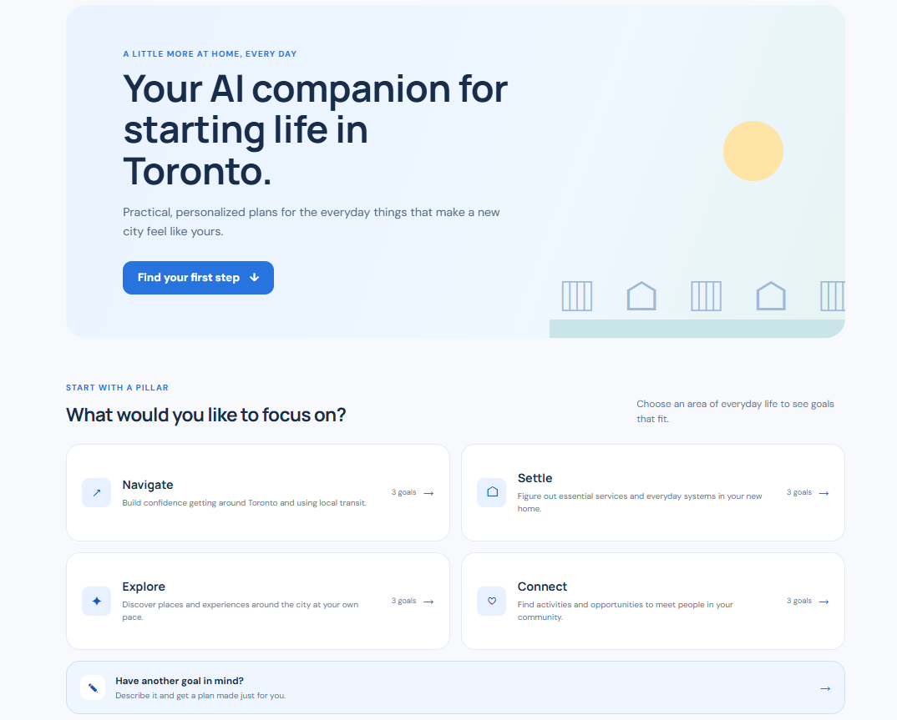
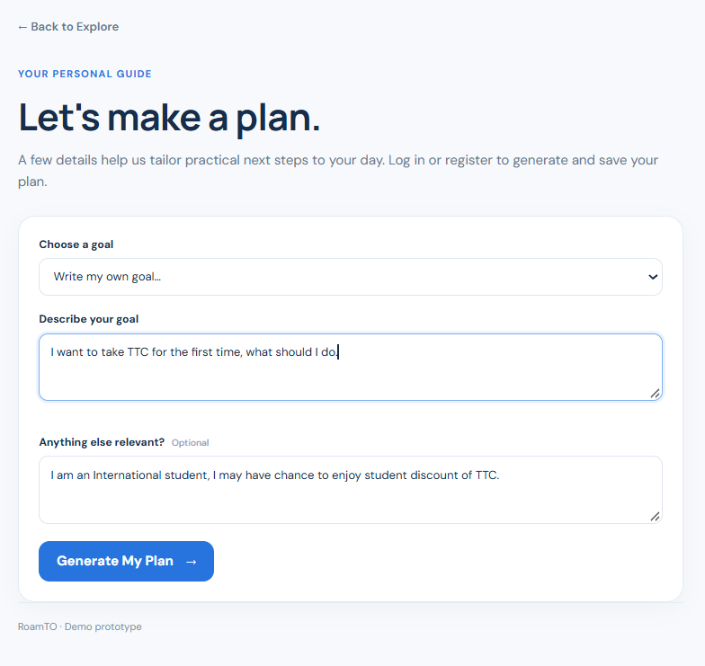
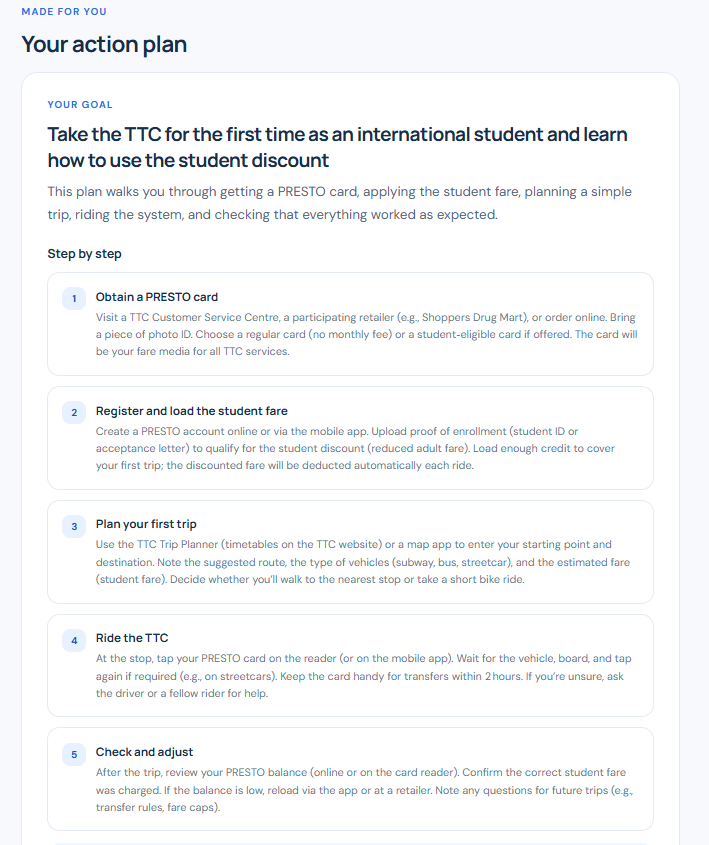
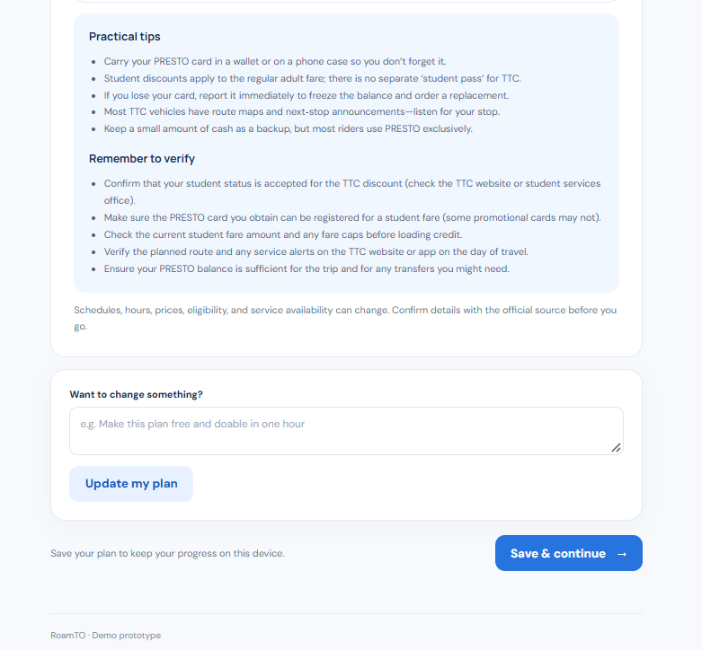
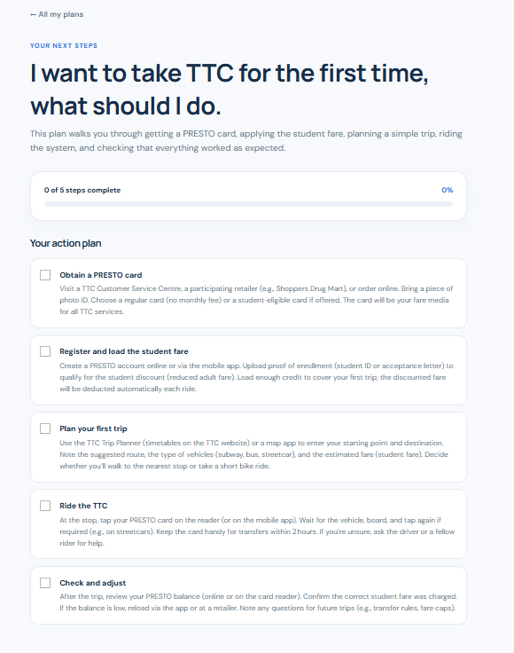
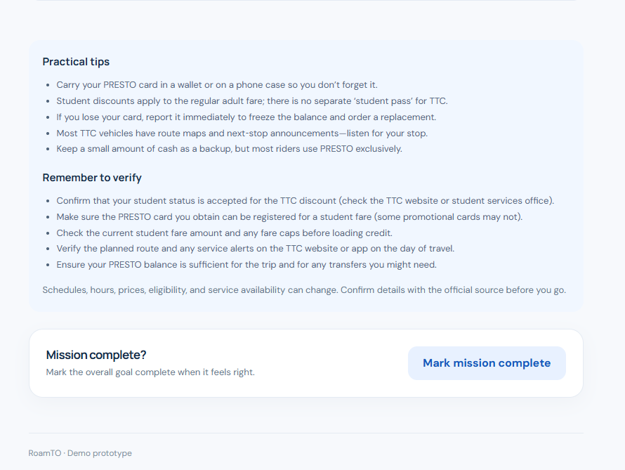
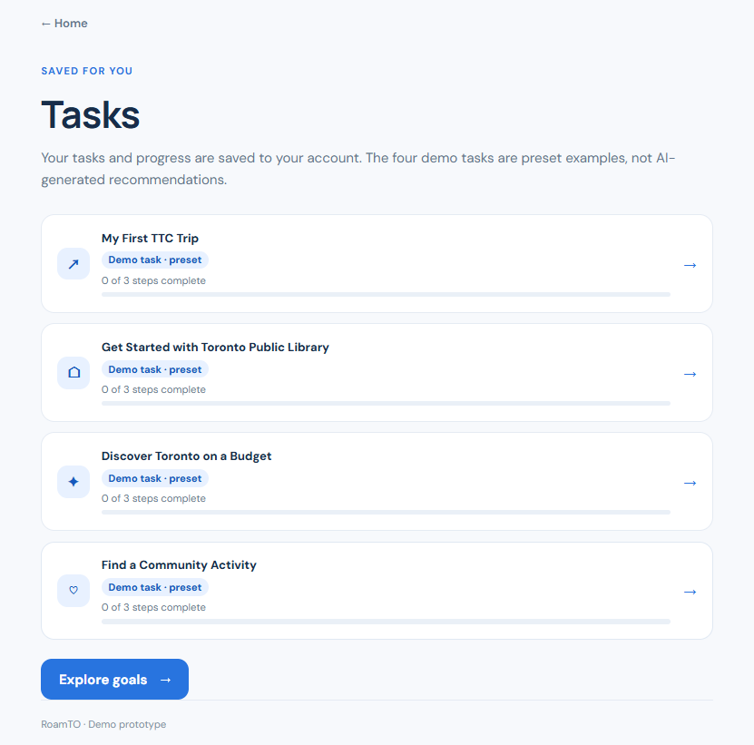

# RoamTO

Moving to a new city means learning how to do everyday things all over again. For newcomers to Toronto, even simple tasks like taking the TTC for the first time, finding a local library, or discovering affordable weekend activities can feel overwhelming.

RoamTO is an AI-powered newcomer companion that transforms these everyday challenges into personalized, actionable plans.

Unlike a general-purpose chatbot, RoamTO combines newcomer-specific missions, contextual AI planning, natural-language refinement, and progress tracking in one experience — helping users move from asking questions to taking action.

While RoamTO is still a prototype, our vision is to develop specialized AI agents for each pillar and deliver increasingly personalized guidance over time.

**Product stage:** MVP  
**Live website:** https://roanto.onrender.com

[Product Overview](#product-overview) | [User Research](#user-research) | [How It Works](#how-roamto-works) | [Try the MVP](#try-the-mvp) | [AI Integration](#why-ai-and-how-personalization-works) | [Technology](#technology-and-architecture) | [Run Locally](#run-locally) | [Roadmap](#future-roadmap)


## Product Overview

### The problem

What feels routine after a few months can feel unfamiliar on the first day. How do I prepare for my first TTC trip? Which library services fit my needs? Where can I start looking for newcomer support or an activity near home?

Answers may be fragmented and spread across transit, library, municipal, and service-provider websites. Unfamiliar terminology, language barriers, and limited neighbourhood knowledge can make it difficult to decide which information applies and what to do next. A collection of links also does not provide a personal record of what has been completed.

RoamTO addresses this gap with **customized advice, manageable next steps, and saved progress**, organized around four areas of newcomer life: Navigate, Settle, Explore, and Connect. It centralizes personal planning and follow-through; it does not replace official services or aggregate all local information in real time.

**Target users:** Newcomers building a life in Toronto, including international students, recent immigrants, and people relocating from another city.

**Mission:** Help newcomers navigate, settle into, and explore Toronto with greater confidence through personalized, AI-powered guidance.

**Vision:** Grow into a more connected, increasingly gamified newcomer-support platform, where practical missions, future achievement badges, local resources, and community opportunities support confidence and belonging.

## User Research

The project included **three newcomer interviews**. The participants' backgrounds at the time of their interviews are summarized below.

| Participant | Background |
| --- | --- |
| **Interviewee 1** | Had lived in Toronto for **2.5 months** and rated their familiarity with the city **6.5/10**. Their everyday activities included grocery shopping and navigating campus, alongside exploring restaurants, shopping, and attending events. |
| **Interviewee 2** | A married newcomer to Toronto who often navigates the city independently while their spouse is working. Most of their free time for exploring the city is on weekends. |
| **Interviewee 3** | An **international graduate student at Ivey Business School** who had been in Canada for **2.5 months** and in Toronto for **20 days**, and described being quite unfamiliar with Toronto. |

For the detailed findings and their implications for product decisions, please refer to the **Interview Findings file submitted with this project**.

## How RoamTO Works

### Four pillars, twelve mission starting points

| Pillar | Purpose | Preset missions |
| --- | --- | --- |
| **Navigate** | Build confidence using transit and understanding fare payment. | My First TTC Trip; Plan a TTC Commute; Learn PRESTO Basics |
| **Settle** | Find a starting point for everyday services and newcomer support. | Get Started with Toronto Public Library; Find a Family Doctor; Explore Newcomer Services |
| **Explore** | Discover Toronto in ways that fit personal interests, time, and budget. | Discover Toronto on a Budget; Explore a Toronto Neighbourhood; Find Free Things to Do |
| **Connect** | Identify local activities and participation opportunities. | Find a Community Activity; Find a Volunteer Opportunity; Meet People in Your Community |

**These twelve missions define goals, not prewritten plans.** Selecting one opens questions relevant to that goal. For example, a TTC trip asks about origin and destination; a library mission asks about neighbourhood and intended use; a budget outing asks about budget, time, starting area, and transport. Additional instructions can capture other preferences. Fields are optional, and not every mission asks every question.

Users can also choose **Write my own goal**. Custom goals use a free-text description and additional instructions rather than a preset mission's question set. This keeps the experience useful when a person's goal falls outside the twelve starting points.

The home screen brings the four pillars together and also offers **Have another goal in mind?** for users who prefer to describe their own goal.



*Home screen: four entry points for everyday newcomer needs, with a separate custom-goal option.*

### Complete workflow

**Choose a Pillar -> Select a Mission -> Add Preferences -> Generate AI Plan -> Refine -> Save & Track Progress**

A custom goal can replace the pillar-and-preset route; refinement is optional.

| Stage | What happens |
| --- | --- |
| **Choose a Pillar** | Start with Navigate, Settle, Explore, or Connect according to the immediate need. |
| **Select a Mission** | Pick a focused goal, or enter a custom goal in the user's own words. |
| **Add Preferences** | Provide relevant constraints and additional instructions so the plan reflects the person's circumstances. |
| **Generate AI Plan** | After sign-in, receive an overview, **three to five action steps**, practical tips, resources where available, and details to verify. |
| **Refine** | Before saving, request a change in natural language, such as "Keep this within one hour" or "Explain the first step more simply." |
| **Save** | Store the plan under the signed-in user's account. |
| **Track Progress** | Open Tasks, check off individual steps, view progress, and separately mark the overall mission complete. |

### Why this design?

| Design choice | Purpose |
| --- | --- |
| **Four pillars** | Help newcomers begin with their immediate need: getting around, accessing services, exploring, or participating locally. |
| **Small, goal-oriented missions** | Offer a manageable starting point without requiring a detailed AI prompt. |
| **Relevant preferences and custom goals** | Collect the context that matters for a task while allowing needs beyond the preset missions. |
| **Generation and optional refinement** | Adapt guidance to the supplied circumstances and let users request changes before saving. |
| **Saved checklists** | Keep the plan and a record of self-reported progress together, so users can return to unfinished steps. |

### Screenshot walkthrough: a custom first-TTC-trip goal

The following screens follow one custom goal from input to a generated draft and then to a saved checklist. The two draft captures show the upper and lower sections of **one page**; the two saved-plan captures likewise show **one page**, not separate features or additional generations.

#### 1. Describe the goal and add personal context

In **Write my own goal...**, the user asks how to take the TTC for the first time. In **Anything else relevant?**, they add that they are an international student and ask about a possible student discount. This is the custom-goal route: personal context is supplied in free text rather than through a preset mission's structured questions. A question about a discount is user context, not confirmation of eligibility.



*The goal and additional context are sent together when the user selects Generate My Plan.*

#### 2. Review the draft, optionally refine it, and save

The upper section displays the generated goal, overview, and five action steps. The lower section continues with **Practical tips**, **Remember to verify**, the **Want to change something?** input, **Update my plan**, and **Save & continue**. Together, these screens show how one request becomes a structured draft that can be reviewed before saving.



*Generated-plan page - upper section: the response reflects the supplied first-trip and student context; factual accuracy still requires verification.*



*The same generated-plan page - lower section: users can enter a change request or save the draft. This capture shows the refinement controls, not a submitted revision or a before-and-after result.*

#### 3. Save the plan and track progress

After **Save & continue**, the plan is available as a saved checklist. The upper section shows the goal, step checkboxes, and a progress indicator. The lower section retains the supporting guidance and provides **Mark mission complete** as a separate control for the overall goal.



*Saved-plan page - upper section: this newly saved example shows **0 of 5 steps complete (0%)**; the capture does not show completed steps.*



*The same saved-plan page - lower section: the user can separately mark the overall mission complete. Step and mission completion are self-reported, not verified real-world activity.*

## Try the MVP

Open the live website above and create an account or sign in with email and password. **No local installation is required.**

Start with the **four demo tasks in Tasks**, then try one personalized plan and, optionally, one refinement. The fixed, labelled demos let you explore saved plans and progress tracking without new AI requests under the demonstration API's usage limits. **They complement live AI generation and refinement; they are not a substitute for those implemented features.** See [Demo API availability](#demo-api-availability) for details.



*Tasks: four cards labelled **Demo task · preset**, one for each pillar. These fixed examples are distinct from the twelve mission starting points.*

### Demo API availability

For demonstration and early evaluation, RoamTO uses **Groq's free API tier** for live plan generation and refinement. Provider limits apply to requests and tokens over minute/day windows and are shared across the hosting organization's usage. Exact allowances depend on the model and account; no fixed daily allowance is promised. See [Groq's rate-limit documentation][groq-limits].

If Groq returns a rate-limit response, RoamTO displays an explicit **"Groq usage limit reached"** message. This indicates temporary provider throttling, not that the AI integration is absent; generation or refinement can be retried after the relevant limit resets. **Other errors can have other causes**, including connectivity, configuration, or provider availability.

Opening demo or saved plans, saving a draft, and updating progress do **not** request new Groq output. They still require the application, authentication, and database to be available. The app does not silently substitute demo content for a failed AI request.

## Why AI and How Personalization Works

A fixed guide is useful for general information, but it cannot adapt its steps to each user's supplied constraints. RoamTO uses AI for **personalized planning and natural-language refinement**, while conventional application logic handles the surrounding workflow.

The distinction from a general-purpose chatbot is the product experience: newcomer-focused starting points, relevant questions, a consistent plan format, and saved progress. Personalization is based on **information supplied for the current plan**, not a trained personal profile or automatic learning from a user's history.

The current MVP uses a shared backend planning service with mission-specific context. **Specialized AI agents for each pillar are a future direction**, not the current architecture.

### One mission, different needs

Consider two users choosing **Discover Toronto on a Budget**:

| Input or planning implication | Example A | Example B |
| --- | --- | --- |
| Starting area | Downtown Toronto | North York |
| Budget | Free activities | Up to CAD 40 |
| Available time | Two hours | Five hours |
| Transportation | Walking | TTC |
| Additional instructions | "I enjoy parks and quiet places. Keep walking distances short." | "I enjoy art and local food. Include a break." |
| How a suitable plan would differ | Focus on a compact sequence of nearby, no-admission activities, with fewer stops and rest opportunities. | Consider a longer sequence of cultural or food-related stops reachable by TTC, subject to the overall budget and current details. |

**This is an illustrative explanation of expected personalization, not recorded participant data or a transcript of tested model outputs.** Exact suggestions vary. The point is that the backend sends different constraints for the same mission, and the model is instructed to adapt the action sequence accordingly, rather than returning a stored mission script. Costs, opening hours, and travel details still require verification.

In this mission, interests are entered through **additional instructions**; they are not a separate budget-mission form field. Other missions, such as neighbourhood exploration, have a dedicated interests question.

### From inputs to a validated plan

```text
Mission or custom goal + relevant preferences + additional instructions
    -> Firebase-authenticated request to FastAPI
    -> Mission context + planning instructions + preset resource catalogue
    -> Groq Chat Completions API
    -> JSON parsing and Pydantic structure validation
    -> Draft -> optional natural-language refinement
    -> Save in SQLite -> track steps and overall completion
```

**What is sent to Groq?** The backend constructs a prompt containing the mission's context, the supplied preferences, any custom-goal text, and formatting instructions. Preset missions also include a curated catalogue of relevant official URLs. Custom goals currently have no preset resource catalogue. The prompt instructs the model to treat blank preferences as unknown, avoid unsupported assumptions, and organize actionable steps around the user's situation.

**How does refinement work?** A request such as "Keep this under one hour and avoid paid activities" is sent with the existing draft and its original context. The model returns a complete revised plan. This changes the draft's guidance before saving; it does not automatically rewrite the original preference fields or provide editing of already-saved plans.

**How is output checked?** The backend requests JSON, parses the response, and validates it with Pydantic. Checks include required fields, data types, text lengths, valid URL formats, three to five steps, and rejection of unexpected fields. Invalid responses produce an error instead of being saved as valid generated plans. **Structure validation is not factual verification or an official-source allowlist check.** The resource restriction is a prompt instruction, and the app does not retrieve the linked pages' live content during generation.

| Responsibility | Implementation |
| --- | --- |
| Generate and refine personalized guidance | Groq API, called server-side through `httpx`. |
| Display pillars, questions, plans, and progress | HTML, CSS, and JavaScript. |
| Register, sign in, and verify identity | Firebase Authentication and backend Firebase ID-token verification. |
| Validate requests and plan structure | FastAPI and Pydantic. |
| Save plans, add demos, update steps, and calculate displayed progress | SQLite persistence and conventional backend/frontend logic; no model call. |

Implementation: [`backend/ai_service.py`](backend/ai_service.py), [`backend/schemas.py`](backend/schemas.py), and [`frontend/app.js`](frontend/app.js).

## Technology and Architecture

| Layer | Technology | Role |
| --- | --- | --- |
| Frontend | HTML, CSS, vanilla JavaScript | Browser interface and API requests; no frontend build step. |
| Backend | Python, FastAPI, Uvicorn | Serve the frontend and API, verify requests, coordinate AI and storage. |
| AI | Groq Chat Completions API via `httpx` | Generate and revise plans; server-side `GROQ_MODEL` selects the model. |
| Validation | Pydantic | Enforce request and plan schemas. |
| Authentication | Firebase Authentication; `google-auth` | Email/password sign-in and server-side ID-token verification. |
| Storage | SQLite | Store account-associated plans, preferences, and completion states. |

**Firebase handles identity; SQLite stores plans and progress.** Passwords are handled by Firebase, not stored in RoamTO's plan database. Protected operations use the verified user ID to scope plan access. The Groq API key stays on the backend; Firebase's web configuration is public client configuration, not a service-account secret. See [Firebase's API-key guidance][firebase-keys].

### Deployment model

One FastAPI application serves the frontend and `/api/...` routes. The browser uses relative API paths, allowing the interface and backend to share a public origin. Configuration is supplied through server environment variables. A hosted deployment must use HTTPS, authorize its domain in Firebase, and retain SQLite on persistent, writable storage.

The repository contains application code rather than a provider-specific deployment manifest. Hosting can use `python -m uvicorn main:app --host 0.0.0.0 --port 8000`, substituting the hosting platform's required port and omitting development reload mode. Set `DATABASE_PATH` to the database file on the persistent volume; an ephemeral filesystem will not preserve plans across redeployments.

<!-- DEPLOYMENT TO COMPLETE: Add the actual hosting provider, verified public URL,
and confirmed persistent-volume setup when the final deployment details are available.
Do not identify a deployment platform or claim hosted persistence without verification.
-->

### Project structure

```text
.
|-- main.py                   # FastAPI entry point, startup, static frontend serving
|-- requirements.txt          # Backend runtime dependencies
|-- .env.example              # Groq and Firebase configuration template
|-- .gitignore                # Excludes local secrets, environments, and database files
|-- docs/
|   `-- screenshots/           # Product screenshots referenced in this README
|-- backend/
|   |-- __init__.py
|   |-- schemas.py            # 12 missions, preference fields, request/plan schemas
|   |-- ai_service.py         # Groq prompts, generation, refinement, response handling
|   |-- auth.py               # Public Firebase config and ID-token verification
|   |-- database.py           # SQLite tables, saved plans, demo seeds, progress
|   `-- routes.py             # Mission, authentication-config, and plan API routes
|-- frontend/
|   |-- index.html            # Pillars and mission entry points
|   |-- ai_plan.html          # Preferences, generated draft, refinement, saving
|   |-- my_plan.html          # Tasks list and individual saved-plan progress
|   |-- login.html            # Email/password registration and sign-in
|   |-- app.js                # Forms, Firebase client auth, API calls, UI updates
|   `-- styles.css            # Interface styling
`-- tests/
    |-- test_ai_service.py    # AI request/response and provider-error tests
    `-- test_auth.py          # Authentication, ownership, and demo-seeding tests
```

## Run Locally

This section is for code review and local development. Evaluators using the public website do not need to follow it.

### Prerequisites

Use **Python 3.10 or newer**, `pip`, a browser, and an internet connection for dependency installation and live Firebase/Groq access. Have a Groq API key and a Firebase project with **Email/Password** authentication enabled. No Node.js, separate frontend server, Firestore instance, or standalone SQLite server is required.

### 1. Install dependencies

Download or clone the repository, then open a terminal in the directory containing `main.py`, `requirements.txt`, and `.env.example`.

**macOS / Linux**

```bash
python3 -m venv .venv
source .venv/bin/activate
python -m pip install -r requirements.txt
cp .env.example .env
```

**Windows PowerShell**

```powershell
py -3 -m venv .venv
.\.venv\Scripts\Activate.ps1
python -m pip install -r requirements.txt
Copy-Item .env.example .env
```

If PowerShell does not permit activation, use `.\.venv\Scripts\python.exe` in place of `python` for the subsequent Python commands. Do not overwrite an existing configured `.env` when updating the project.

### 2. Configure Groq and Firebase

Create a key in the [Groq Console][groq-keys]. In the [Firebase Console][firebase-console], create or select a project, register a Web app, and enable **Email/Password** under Authentication's sign-in providers. Copy the web app's `apiKey`, `authDomain`, `projectId`, and `appId` into the matching variables below. Check Authentication's authorized domains and add `localhost` and `127.0.0.1` for local use as needed; add the actual public domain for deployment. See [Firebase web setup][firebase-setup] and [password authentication][firebase-password].

Edit the root `.env` file with your own values. The values below are placeholders, not usable credentials.

```dotenv
GROQ_API_KEY=your_groq_api_key
FIREBASE_API_KEY=your_firebase_web_api_key
FIREBASE_AUTH_DOMAIN=your-project-id.firebaseapp.com
FIREBASE_PROJECT_ID=your-project-id
FIREBASE_APP_ID=your_firebase_web_app_id

# Optional: the source-code default is shown below.
# Use a model enabled for your Groq account.
GROQ_MODEL=openai/gpt-oss-120b

# Optional: supported by backend/database.py, even though not in .env.example.
# Relative paths are resolved from the server's working directory.
# DATABASE_PATH=./roamto.db
```

Keep `.env` out of version control; it is already listed in `.gitignore`. Do not place the Groq key in frontend code. The normal setup verifies Firebase tokens with `google-auth` and does not require a Firebase Admin service-account JSON file.

Leave `FIREBASE_AUTH_EMULATOR_HOST` **unset** for normal Firebase use and all public deployments. It is an optional, local-emulator-only setting, not a production authentication shortcut. Restart the application after changing configuration.

### 3. Start the application

From the repository root, with the virtual environment active:

```bash
python -m uvicorn main:app --reload --host 127.0.0.1 --port 8000
```

Open `http://127.0.0.1:8000`. FastAPI serves the frontend directly. The mission catalogue is available at `http://127.0.0.1:8000/api/missions`, and interactive API documentation at `http://127.0.0.1:8000/docs`. Protected plan endpoints require a valid Firebase ID token. The command follows FastAPI's [Uvicorn server pattern][fastapi-server].

### 4. Database initialization and persistence

Startup creates the required SQLite tables automatically. By default, the file is **`roamto.db` in the repository root**; no manual database initialization command is needed. `DATABASE_PATH` can point to another writable file, and the backend creates missing parent directories.

Saved plans persist when the same database file is retained. Opening Tasks seeds four demo plans once per account. Local files and hosted files are separate; deploying the source does not automatically transfer a local database. A deployment therefore needs persistent storage, not just a writable temporary directory.

### 5. Run the repository tests

`pytest` is a test dependency and is not listed in the runtime requirements:

```bash
python -m pip install pytest
python -m pytest -q
```

The supplied tests use mocked provider responses and authentication checks. They cover AI request handling, provider errors, token verification paths, user-scoped plan access, and one-time demo seeding. They do not replace an end-to-end check of the deployed website with live Firebase and Groq services.

## Product Scope and Responsible Use

**Guidance, not verified live services.** Confirm current fares, schedules, opening hours, prices, eligibility, and availability with official sources. The MVP does not provide live navigation, make bookings, submit government applications, or make medical decisions. The family-doctor mission concerns finding service information, not diagnosis or treatment.

**Current progress features.** Refinement applies to a generated draft before saving. Editing and deleting saved plans remain future work. Step and mission completion are self-reported. Connect provides participation guidance, not an in-app social network. Achievement badges are planned, not implemented.

**Data use.** Goals, preferences, and relevant draft/change text are sent to Groq for planning or revision. Saved plans and preferences are associated with the authenticated user ID. Enter only the context needed for planning, not SINs, identity-document numbers, or medical records.

## Future Roadmap

These are proposed next steps, not available features or committed release dates.

| Priority area | Proposed next step |
| --- | --- |
| **Usability and language** | Test the core journey with more newcomers; improve accessibility and add multilingual support. |
| **Information reliability** | Maintain official resources, introduce freshness indicators, and evaluate retrieval or selected live-data integrations. |
| **Saved-plan management** | Add editing, deletion, and clearer organization of saved goals. |
| **Gamification** | Build optional achievement badges, such as **First Ride**, and personal milestones on the existing mission/checklist foundation. |
| **Broader settlement needs** | Evaluate reviewed guides for grocery errands, official SIN/identification information, and Ontario Photo Card guidance. These are not current dedicated missions. |
| **Community and partnerships** | Explore safe community participation features and collaboration with libraries, newcomer organizations, and local businesses. |

Longer-term expansion to other cities would require local resources and further validation. The aim is to help newcomers recognize meaningful progress and feel more at home, not simply generate more plans.

[groq-limits]: https://console.groq.com/docs/rate-limits
[groq-keys]: https://console.groq.com/keys
[firebase-console]: https://console.firebase.google.com/
[firebase-setup]: https://firebase.google.com/docs/web/setup
[firebase-password]: https://firebase.google.com/docs/auth/web/password-auth
[firebase-keys]: https://firebase.google.com/docs/projects/api-keys
[fastapi-server]: https://fastapi.tiangolo.com/deployment/manually/

[ttc-students]: https://www.ttc.ca/riding-the-ttc/Students
